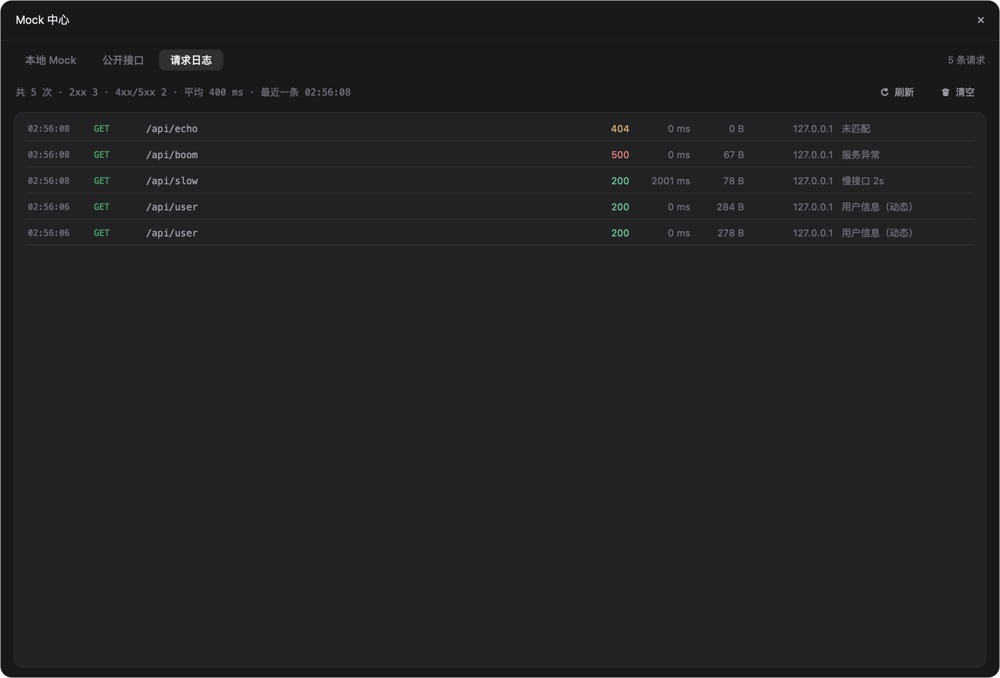
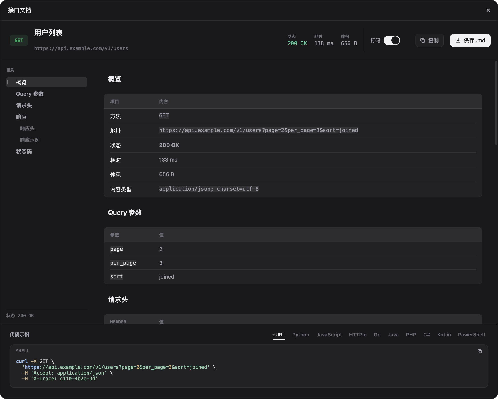

# Ocelot

调接口用的桌面工具。发请求、看响应、起本地 Mock、顺手出份接口文档。

不用注册，没有遥测，数据是一个 JSON 文件，想备份就拷走。


## 装

```bash
git clone https://github.com/shaoao/Oceloat.git
cd Oceloat
python3 -m pip install PyQt6
python3 main.py
```

Python 3.10+，PyQt6 6.5+。macOS 上也可以双击 `启动 Ocelot.command`。第一次打开自带几条示例请求，点一下就能发。

不想装 Python 就直接用打好的 App：`dist/Ocelot.app`，或者拖进「应用程序」的 `Ocelot-1.0.71.dmg`。包是自签名的，第一次打开如果被拦，去「系统设置 → 隐私与安全性」点一次「仍要打开」。

## 发请求

GET / POST / PUT / PATCH / DELETE / HEAD / OPTIONS 都有。参数、请求头、Cookies、请求体和认证分开填，互不打架；JSON 请求体边写边校验。

响应有八种看法：美化、树形、原始、响应头、Cookies、图片和音视频预览、跟上一次对比、按路径提取字段。


WebSocket 和 Socket.IO 是独立的请求类型，有整页界面：文本 / JSON / 二进制收发、子协议、心跳与往返延迟、断线重连、帧日志。

前后置脚本是 JavaScript，能改请求、读响应、写环境变量、写断言，输出进响应面板的控制台。

## Mock 是真的在跑服务

不是把域名换个写法。它在 `127.0.0.1` 上起一个真的 HTTP 服务，浏览器、curl、前端 dev server 都能直接连，关掉就干净退出。


一条路由可以设方法、路径、状态码、Content-Type、返回体；可以延迟多少毫秒再返回，用来测 loading 和超时；返回体里写 `{{@uuid}}`、`{{@int(1,99)}}` 每次现算；也能按请求头、参数或请求体切响应 —— 带 `token=123` 给 VIP 数据，不带给 401。

几个用起来省事的点：

- 多实例：各占一个端口、各有一份路由，同时开着，模拟「订单服务 + 商品服务」的调用链不用来回改端口
- 一键 Mock：普通请求面板点一下，把当前 Method、Path 和真实响应体直接变成一条本地路由
- 导入：OpenAPI 3 / Swagger 2 / Postman 集合，按文件里的 tag、文件夹自动分组
- 局域网 + 二维码：手机扫一下就能连，没开局域网时不显示扫码按钮



服务跑着的时候，右下角有个绿点胶囊显示端口，点一下回到 Mock 中心；服务停着就整条收起、不留空位。

## 接口文档

把一次请求连同响应生成 Markdown，带代码示例，语言可换，能复制能存盘，也可以直接发人。



## 文件和占用

设置菜单里的「资源管理器」是个文件管理器，不是仪表盘：进目录、按名称 / 大小 / 时间排序、筛选、双击打开、在 Finder 中显示、新建文件夹、重命名，删除走系统废纸篓，删错了还能捡回来。

顶部一行说清应用数据占多少、哪类文件占多少、磁盘还剩多少。旁边那颗「清理旧文件」清的是过期回收站、7 天前的自动备份和 AI 分析缓存 —— 都是删了不丢数据的东西。

内存不在这儿看。程序默认每 15 分钟在后台收一次：跑两轮 GC、丢掉可再生的图标缓存，再让分配器把空闲页真正还给系统。「设置 → 通用」里能关掉、改成 5 或 30 分钟，也能立刻来一次。

## 其他

- 命令面板 ⌘K：搜请求、切环境、跑命令
- 导入导出：Ocelot JSON / Postman / Apifox / Hoppscotch / Insomnia / OpenAPI / HAR，Ocelot JSON 就是 Postman v2.1 加了层元数据，别的工具能直接读
- 十种语言的代码片段，一键复制；粘贴 cURL 也能反过来导入
- 云同步（可选）：换台电脑把快照拉回来
- 亮色 / 暗色两套主题
- AI 部分是可选的，不填 Key 就彻底不联网

## 快捷键

| 键 | 作用 |
| --- | --- |
| ⌘N / ⌘T | 新建请求 |
| ⌘W | 关标签 |
| ⌘↵ | 发送 / 取消 |
| ⌘S | 存进集合 |
| ⌘K | 命令面板 |
| ⌘F | 在响应里找 |
| ⌘B | 收 / 展侧栏 |
| ⌘⇧R | 跑完当前集合 |
| ⌘, | 设置 |

都能在「设置 → 快捷键」里改。

## 数据在哪

`~/Library/Application Support/Ocelot/state.json`，一个 JSON，先写临时文件再改名。

旁边会攒几份 `state.json.bak-时间`：每次落盘前自动留上一份，最多 5 份、10 分钟一份。存档读不出来的时候不会悄悄换成示例数据 —— 坏文件改名成 `state.json.corrupt-时间` 留着，程序自己挑最近一份能读的备份恢复，并在界面上说一声。想手动退回某天，在「资源管理器」里右键那份备份，选「用这份存档恢复」。

早期版本叫 Reqly，旧数据第一次启动会自动搬过来。

**只有两个操作会真的删数据**：清空回收站（和回收站到期自动清理），以及「从云端恢复」用云端快照覆盖本机。后者现在会先备份、并在云端比本机少的时候问一句。

## 开发

代码在 `app/` 下，一个功能一个文件，界面全部用 QPainter 画，不引图片资源。

```bash
python3 tools/smoke.py        # 709 项自测，会真起 HTTP / WebSocket 服务
python3 tools/check_brand.py  # 标识、版本与打包配方检查
python3 tools/readme_shots.py # 重新生成上文截图
python3 tools/build_app.py    # 打包成 Ocelot.app + dmg（约 62MB / 27MB）
```

打包后的 App 自带 Python 和 Qt，双击就开，不用装环境。`python3 main.py --self-test` 会导一遍所有模块、起一次 Mock、渲染一次窗口，打包脚本拿它验收产物。

发版：改 `app/store.py` 的 `VERSION`（末位加一），往 `CHANGELOG` 写几条。软件里「设置 → 关于 → 更新内容」读的就是它。

## 许可

MIT。
