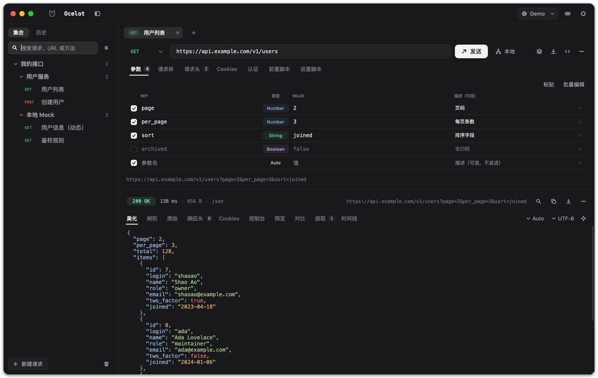
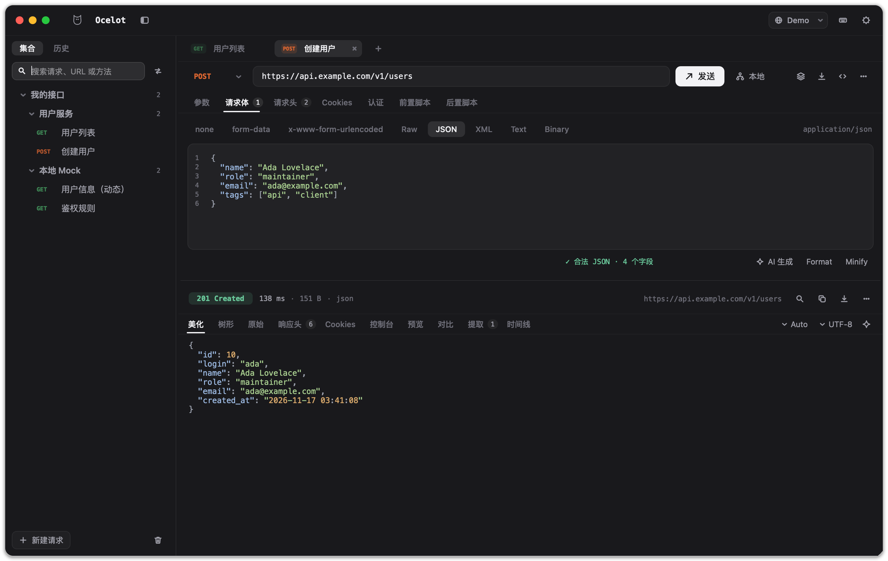
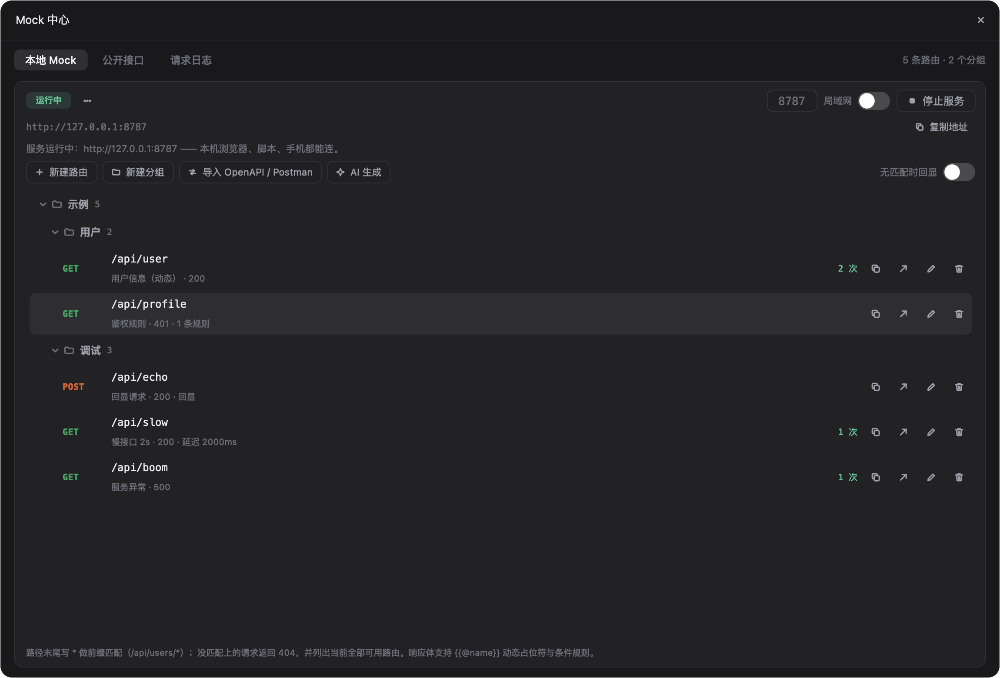
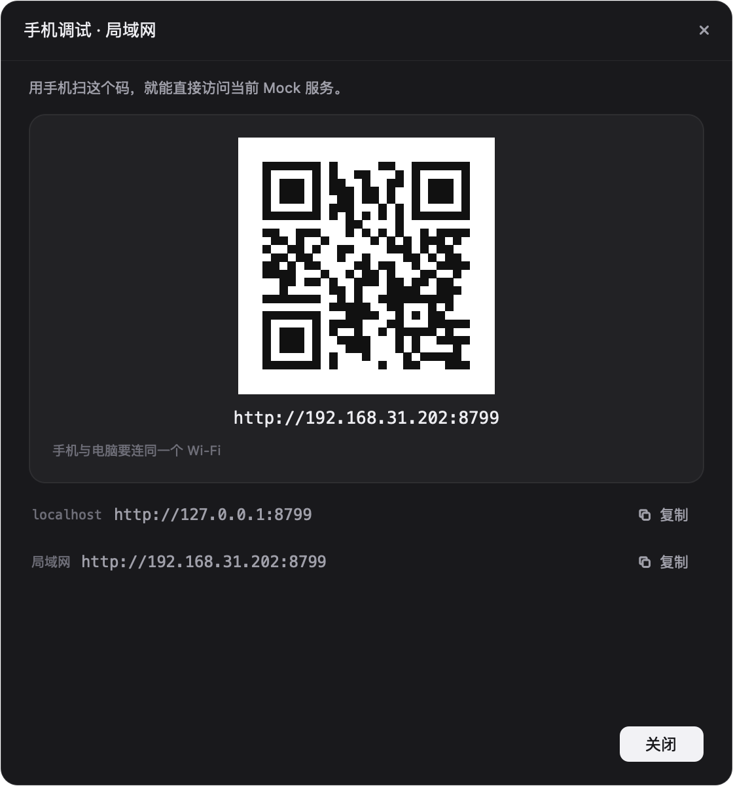
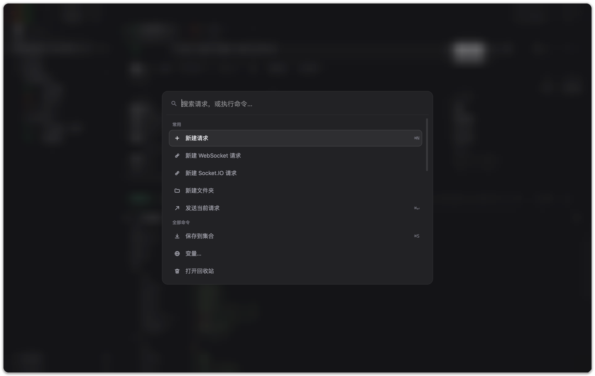
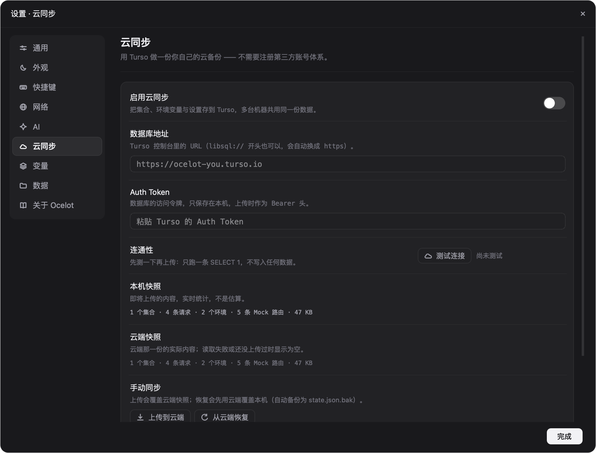
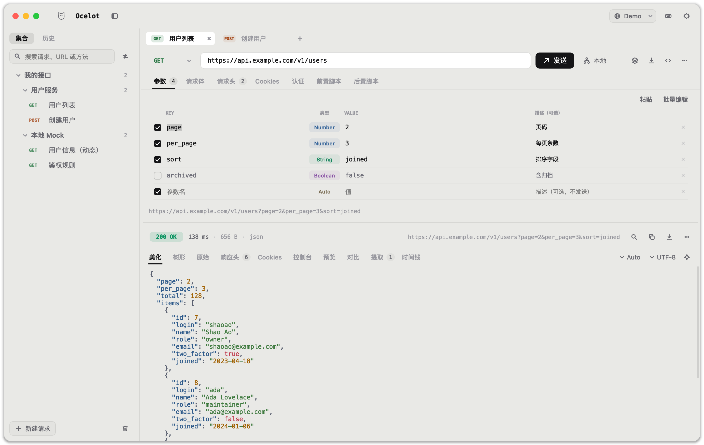

# Ocelot

一个把请求、Mock、脚本和文档都装进同一个窗口的 API 调试工具。

窗口、按钮、图标都是代码画的，不依赖图片资源，也没有乱七八糟的第三方库。
启动快、占内存少，请求多的时候也不卡。



## 为什么要用它

- **一个窗口干完活**：调试接口、起 Mock、写脚本、生成文档、同步数据，不用在好几个软件之间来回切。
- **快而且轻**：界面自己画，日志增量刷新，滚动时不反复创建字体和图标；开着不跑 Mock 时定时器完全停掉。
- **断网也能调**：Mock 在本机真起一个 HTTP 服务，浏览器、curl、前端 dev server 都能直接连。
- **数据在你自己手里**：所有东西存成一个 JSON，备份、diff、换电脑都简单；云同步是可选的。
- **界面不啰嗦**：纯色卡片、白灰层次、没有渐变光带；亮色 / 暗色两套主题。

## 装上就能用

```bash
git clone https://github.com/shaoao/Oceloat.git
cd Oceloat
python3 -m pip install PyQt6
python3 main.py
```

需要 Python 3.10+ 和 PyQt6 6.5+。macOS 上也可以直接双击 `启动 Ocelot.command`。

第一次打开自带几条示例请求，点一下就能发。

## 发请求和看响应

GET / POST / PUT / PATCH / DELETE / HEAD / OPTIONS 都支持；参数、请求头、Cookies、请求体、认证分开填，互不干扰。JSON 请求体边写边校验。



响应有八种看法：美化、树形、原始、响应头、Cookies、图片和音视频预览、跟上一次对比、按路径提取字段。每页都能让 AI 分析当前内容。


WebSocket 和 Socket.IO 是独立的请求类型，有整页界面：文本 / JSON / 二进制收发、子协议、心跳与往返延迟、断线自动重连、可折叠的握手头、常用消息胶囊、帧日志（过滤 / 搜索 / 复制 / 导出 / 双击重放 / 多展开详情卡）。

前置 / 后置 JavaScript 能改请求、读响应、写环境变量、写断言，输出都进响应面板的「控制台」。

## Mock：本机真的起一个服务

不是在地址栏里改个域名，而是用标准库 `http.server` 在 `127.0.0.1` 上启动一个 HTTP 服务。路由、状态码、延迟、返回内容都由你定，服务关掉就干净退出。



一条路由能做的事：

- 指定方法、路径、状态码、Content-Type 和返回内容
- 延迟多少毫秒返回，用来测 loading 和超时
- 返回内容里写 `{{@uuid}}`、`{{@name}}`、`{{@int(1,99)}}` 这类占位符，每次请求现算
- 按请求头、查询参数、请求体或方法匹配条件，命中就换一套响应。比如带 `token=123` 返回 VIP 数据，不带返回 401
- 路径结尾写 `*` 做前缀匹配，`/api/users/*` 能接住 `/api/users/42`

请求日志页记录每次请求打到哪条路由、命中哪条规则、花了多久，以及响应体积和来源 IP。日志一行只画一次，几百条也不卡。


更省事的几件事：

- **多实例**：一个窗口里可以开多个实例，各占一个端口、各有一份路由，能同时启动。模拟「订单服务 + 商品服务」这种互相调用的链路时，不用来回改端口。
- **一键 Mock**：在普通请求面板点一下，就把当前的 Method、Path 和真实响应体变成一条本地 Mock 路由；服务没开会顺手拉起来。
- **分组树**：路由按 `订单/支付` 这样的层级分组，可折叠、可重命名。导入 OpenAPI（3 / Swagger 2）或 Postman 集合时，按文件里的 tag / 文件夹自动分好类，一次把整个项目的接口全量变成 Mock 路由。
- **AI 生成**：一个入口两种结果 —— 一句话描述业务就长出一组互相呼应的路由与响应体；切到「生成用例」则给现有路由生成测试用例（正常 / 参数缺失 / 边界 / 鉴权失败），每条可复制成 cURL。
- **局域网 + 二维码**：打开「局域网」后监听 `0.0.0.0`，面板给出局域网地址，旁边的「扫码」按钮出二维码，手机扫一下就能连。没开局域网时不显示这个按钮。二维码是纯标准库自己算的，没加依赖。



- **状态栏徽章**：服务跑起来时右下角（右半侧内容区底部）出现「绿点 + Mock: 8787 运行中」，点一下秒回 Mock 中心。左边侧栏的位置始终不变，服务停着时整条收起。
- **自检**：启动后会探活一次，端口在但服务没响应时徽章显示「无响应」并转成警示色；端口被占用、或路由里有重复的「方法 + 路径」，会在启动提示里直接点名。

## 命令面板

按 ⌘K 打开：搜请求、切环境、跑命令都在一个框里。常用五条按你自己的使用频率置顶，用得越多排得越靠前。



## 接口文档

把一次请求连同响应生成一份 Markdown，带代码示例。语言可以换，能复制、能存成 `.md`，直接发给别人。


## 数据和互通

- **集合、变量、历史**：环境变量和全局变量在同一页切换，`{{名字}}` 引用，环境优先。
- **导入导出**：Ocelot JSON / Postman / Apifox / Hoppscotch / Insomnia / OpenAPI（JSON、YAML）/ HAR 之间互通。Ocelot JSON 就是 Postman v2.1 加一层 `x-ocelot` 元数据，别的工具直接能读，导回来也不丢脚本和认证。
- **导入前预览**：先告诉你识别成什么格式、几个请求，导入后有一页明细清单。也能直接从剪贴板或远程 URL 拉一份 JSON / YAML 进来。
- **代码生成**：十种语言，一键复制。
- **cURL 导入**：把浏览器里复制的 cURL 直接贴进来。
- **云同步**：用 Turso 存一份快照，换台电脑能拉回来；改名、改请求都会自动同步。设置页分别显示「本机快照」和「云端快照」的真实统计（集合 / 请求 / 环境 / Mock 路由 / 体积），上传时同批写元数据。



- **资源管理器**：右上角设置菜单里，一屏看完进程内存与走势、应用数据按类别拆开的占用、磁盘余量和健康分；两颗按钮搞定「释放内存」和「一键清理」。

## AI（可选）

有个总开关，不想用可以彻底关掉。填智谱 GLM 的 Key 就能：

- 按字段名生成真实数据
- 按当前响应页签分析内容与报错
- 补全接口文档
- 自动给请求起名
- Mock 里生成路由和测试用例

模型可换，也能填中转地址。

## 主题和标识

亮色 / 暗色两套，设置里切换。




欢迎页、标题栏、关于页、响应空状态和 Dock 用同一枚细线豹猫脸：尖耳、圆颊、窄下颌，两只竖椭圆眼、倒三角鼻、两颗不对称豹斑。鼠标悬浮时一条墨线从下颌出发沿轮廓把自己写一遍，笔尖带三点拖尾和萤火，五官随后依次点亮。

## 快捷键

| 键 | 作用 |
| --- | --- |
| ⌘N / ⌘T | 新建请求 |
| ⌘W | 关掉当前标签 |
| ⌘↵ | 发送 / 取消 |
| ⌘S | 存进集合 |
| ⌘K | 命令面板 |
| ⌘F | 在响应里找 |
| ⌘B | 收 / 展侧栏 |
| ⌘⇧R | 跑完当前集合 |
| ⌘, | 设置 |

都能在「设置 → 快捷键」里改，也可以清空。

## 数据存在哪

`~/Library/Application Support/Ocelot/state.json`，就是个 JSON 文件，写的时候先写临时文件再改名，不会写坏。

想备份或者想 diff，直接拿这个文件就行。早期版本叫 Reqly，旧目录里的数据第一次启动时会自动搬过来。

## 开发说明

代码都在 `app/` 下，一个功能一个文件：

```
main.py               启动入口
app/main_window.py    主窗口、侧栏、标签、快捷键
app/app_menu.py       macOS 原生应用菜单
app/request_panel.py  地址栏和参数 / 请求头 / Cookies / 请求体 / 认证
app/response_panel.py 响应区（八种视图）
app/mock_server.py    Mock 服务本体（多实例 Hub、局域网、分组、日志）
app/mock_panel.py     Mock 中心界面（分组树、状态、日志、二维码）
app/mock_import.py    OpenAPI / Postman 转 Mock 路由
app/mock_ai.py        Mock 的 AI 提示词与结果清洗
app/qr.py             纯标准库二维码
app/cloud.py          云同步快照与统计
app/markdown_view.py  Markdown 渲染，表格和代码块是自己画的控件
app/doc_window.py     接口文档窗口
app/theme.py          颜色、字体、全局样式
app/widgets.py        自己画的控件（按钮、分段标签、开关、滚动区…）
app/icons.py          所有图标，用 QPainter 描边画的
app/store.py          数据和设置，存在一个 JSON 里
app/ai.py             AI 客户端（智谱 GLM），流式输出 + 提示词
```

写的时候守几条：

- 颜色只从 `theme.py` 取，不在控件里写死色值，不然换主题会有地方漏掉
- 图标统一在 `icons.py` 里画，不引图片
- 改完界面先跑一遍自测

```bash
python3 tools/smoke.py         # 679 项检查，会真的起本地 HTTP 与 WebSocket 服务
python3 tools/check_brand.py   # 121 项品牌与版本检查
python3 tools/readme_shots.py  # 重新生成 README 里的截图，输出到 docs/
```

发版：改 `app/store.py` 里的 `VERSION`，末位加一，再往 `CHANGELOG` 里写几条。软件里「设置 → 关于 → 更新内容」读的就是它。

## 遇到问题

**响应是乱码或者一片空白**
带 `gzip / deflate / br` 的响应会自动解压；没声明编码的按 UTF-8、GB18030 依次试。还是不对，去「原始」视图看字节。

**Mock 显示已停止，浏览器却还能访问**
旧版本只关了监听端口，浏览器那条复用连接还活着，1.0.18 起停止时会一起断开。如果还能访问，看面板提示，8787 可能被别的程序或者另一个 Ocelot 占着。

**点 IDE 上的运行按钮没反应**
运行面板用的解释器可能没装 PyQt6，启动时会打印当前解释器路径和修复命令，或者直接在终端 `python3 main.py`。

## 许可

MIT，随便用。
