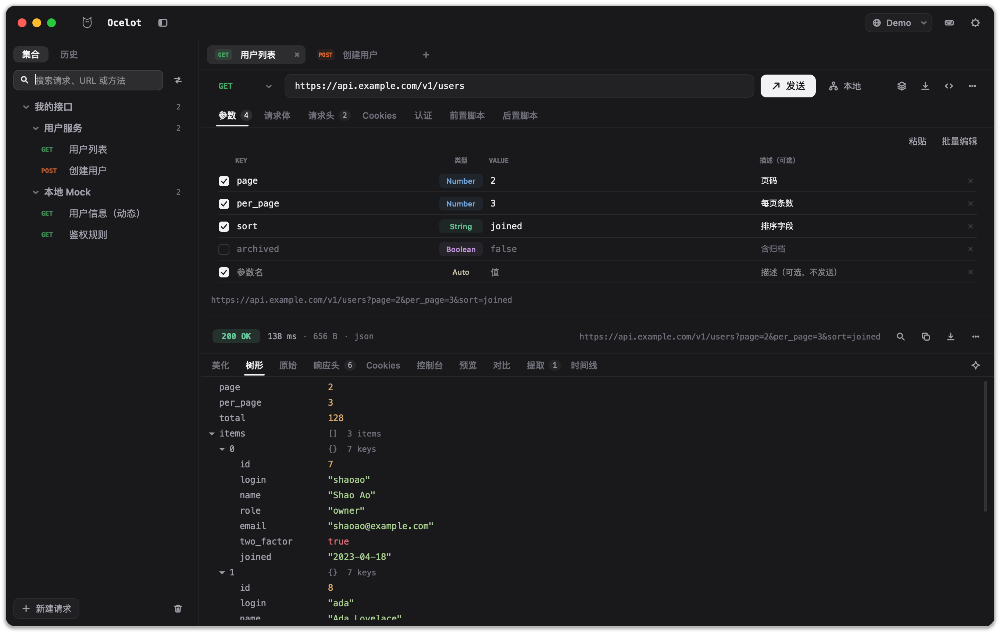
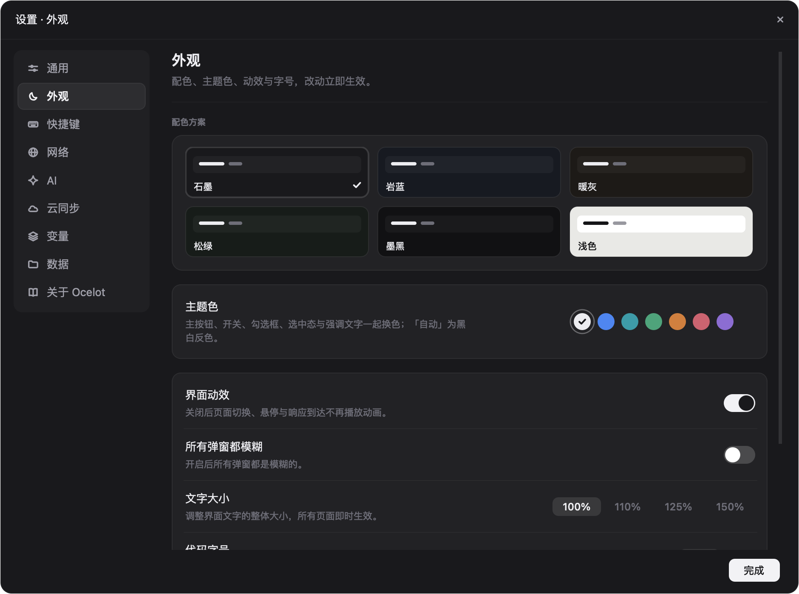

# Ocelot

Ocelot 是一个为 macOS 写的 API 调试工具，Python + PyQt6 实现，窗口、按钮、图标全是自己画的，没有用任何图片资源。

平时我自己调接口就用它，所以里面的东西基本是照着「怎么顺手怎么来」加的。


## 能干什么

- 发请求：GET / POST / PUT / PATCH / DELETE / HEAD / OPTIONS，参数、请求头、Cookies、请求体、认证分开填
- WebSocket：一类独立的请求（从「新建请求」建，不出现在方法下拉里），自带整页界面 ——
  文本 / JSON / 二进制收发、子协议、心跳与往返延迟、断线自动重连、可折叠的握手头、
  常用消息胶囊、帧日志（过滤 / 搜索 / 复制 / 导出 / 双击重放 / 多展开详情卡）
- 看响应：美化、树形、原始、响应头、Cookies、图片和音视频预览、跟上一次响应对比、按路径提取字段
- 本地 Mock：在自己电脑上起一个 HTTP 服务，路由、状态码、延迟、返回内容都由你定，断网也能调
- 出文档：把一次请求连同响应生成一份 Markdown，带代码示例，可以直接发给别人
- 存起来复用：集合、多环境变量、历史记录、十种语言的代码生成、导入 cURL 和 Postman
- 命令面板（⌘K）：常用五条按使用频率置顶，下面是全部命令、环境切换和请求跳转
- 跑脚本：前置 / 后置 JavaScript，能改请求、读响应、写环境变量、写断言，输出都进响应面板的「控制台」
- 互通：一键在 Ocelot JSON / Postman / Apifox / Hoppscotch / Insomnia / OpenAPI（JSON、YAML）/ HAR 之间导入导出，
  Ocelot JSON 就是 Postman v2.1 加一层 x-ocelot 元数据，别的工具直接能读，导回来也不丢脚本和认证；
  导入前先告诉你识别成什么格式、几个请求，导入后有一页明细清单；
  也能直接从剪贴板或远程 URL 拉一份 JSON / YAML 进来，集合会按文件里的名字建成目录
- 云同步：用 Turso 存一份快照，换台电脑能拉回来；改名、改请求都会自动同步

其余的功能在软件里点一遍基本能看见，这里就不一条条列了。

## 运行

```bash
git clone https://github.com/shaoao/Oceloat.git
cd Oceloat
python3 -m pip install PyQt6
python3 main.py
```

需要 Python 3.10+ 和 PyQt6 6.5+。macOS 上也可以直接双击 `启动 Ocelot.command`。

第一次打开会带几条示例请求（httpbin 和 JSONPlaceholder），点一下就能发。

## 几张截图

请求体，JSON 是边写边校验的：


响应树形视图：



本地 Mock，右边是每条路由被调了几次：


接口文档窗口，代码示例可以换语言、复制、存成 .md：


浅色主题和设置页：




## 关于 Mock

这个 Mock 不是把公开接口的地址填进地址栏，而是在本机 `127.0.0.1` 上真的起一个 HTTP 服务
（用的标准库 `http.server`，没装额外依赖）。

所以浏览器、curl、前端 dev server 都能直接连它，服务关掉就干净退出。

一条路由能做的事：

- 指定方法、路径、状态码、Content-Type 和返回内容
- 延迟多少毫秒返回，用来测 loading 和超时
- 返回内容里写 `{{@uuid}}`、`{{@name}}`、`{{@int(1,99)}}` 这类占位符，每次请求现算
- 按请求头、查询参数、请求体或方法匹配条件，命中就换一套响应。比如带 `token=123` 返回 VIP 数据，不带返回 401
- 路径结尾写 `*` 做前缀匹配，`/api/users/*` 能接住 `/api/users/42`

面板里还有一个「请求日志」页，能看每次请求打到哪条路由、命中哪条规则、花了多久。

## 快捷键

| 键 | 作用 |
| --- | --- |
| ⌘N / ⌘T | 新建请求 |
| ⌘W | 关掉当前标签 |
| ⌘↵ | 发送 / 取消 |
| ⌘S | 存进集合 |
| ⌘K | 命令面板 |
| ⌘F | 在响应里找 |
| ⌘B | 收 / 展侧栏 |
| ⌘⇧R | 跑完当前集合 |
| ⌘, | 设置 |

这些都能在「设置 → 快捷键」里改，也可以清空。

## 开发说明

代码都在 `app/` 下，一个功能一个文件，看名字大概能猜到是做什么的：

```
main.py               启动入口
app/main_window.py    主窗口、侧栏、标签、快捷键
app/request_panel.py  地址栏和参数 / 请求头 / Cookies / 请求体 / 认证
app/response_panel.py 响应区（八种视图）
app/mock_server.py    Mock 服务本体
app/mock_panel.py     Mock 中心界面
app/markdown_view.py  Markdown 渲染，表格和代码块是自己画的控件
app/doc_window.py     接口文档窗口
app/theme.py          颜色、字体、全局样式
app/widgets.py        自己画的控件（按钮、分段标签、开关、滚动区…）
app/icons.py          所有图标，用 QPainter 描边画的
app/store.py          数据和设置，存在一个 JSON 里
```

写的时候尽量守几条：

- 颜色只从 `theme.py` 取，不在控件里写死色值，不然换主题会有地方漏掉
- 图标统一在 `icons.py` 里画，不引图片
- 改完界面先跑一遍自测，排版、按钮状态、鼠标事件这些都在里面

跑测试和截图：

```bash
python3 tools/smoke.py         # 544 项检查，会真的起本地 HTTP 与 WebSocket 服务
python3 tools/readme_shots.py  # 重新生成 README 里的截图，输出到 docs/
```

发版：改 `app/store.py` 里的 `VERSION`，末位加一，再往 `CHANGELOG` 里写几条。软件里
「设置 → 关于 → 更新内容」读的就是它。

## 数据存在哪

`~/Library/Application Support/Ocelot/state.json`，就是个 JSON 文件，写的时候先写临时文件再改名，不会写坏。

想备份或者想 diff，直接拿这个文件就行。早期版本叫 Reqly，旧目录里的数据第一次启动时会自动搬过来。

## 遇到问题

**响应是乱码或者一片空白**
带 `gzip / deflate / br` 的响应会自动解压；没声明编码的按 UTF-8、GB18030 依次试。还是不对，去「原始」视图看字节。

**Mock 显示已停止，浏览器却还能访问**
旧版本只关了监听端口，浏览器那条复用连接还活着，1.0.18 起停止时会一起断开。如果还能访问，看面板提示，
8787 可能被别的程序或者另一个 Ocelot 占着。

**点 IDE 上的运行按钮没反应**
运行面板用的解释器可能没装 PyQt6，启动时会打印当前解释器路径和修复命令，或者直接在终端 `python3 main.py`。

## 许可

MIT，随便用。
