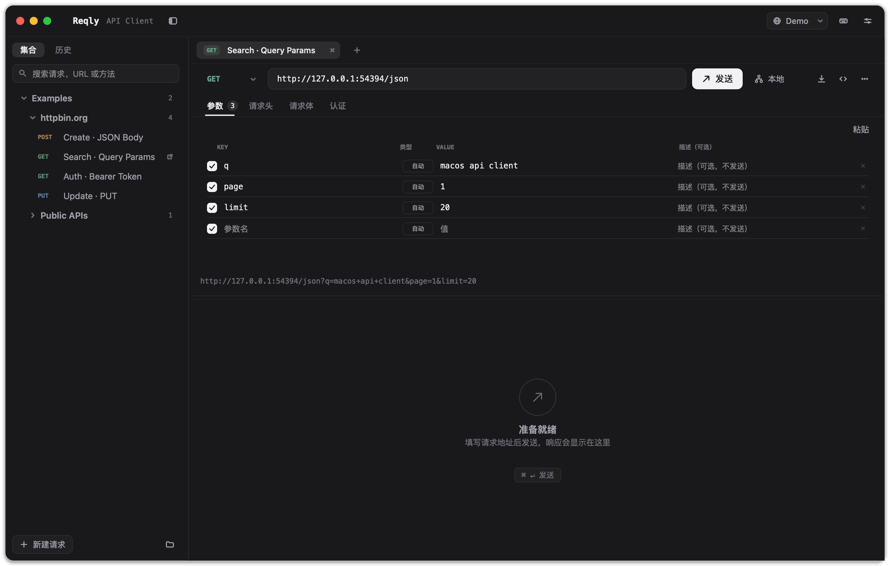
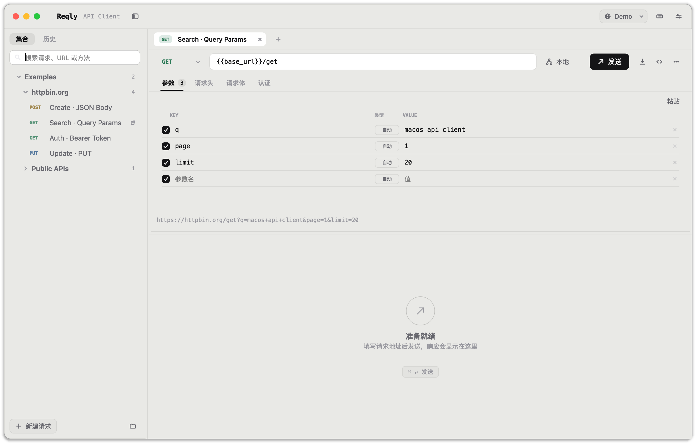
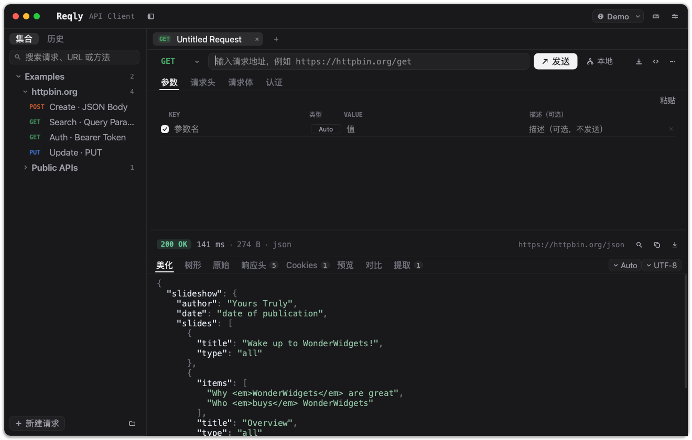
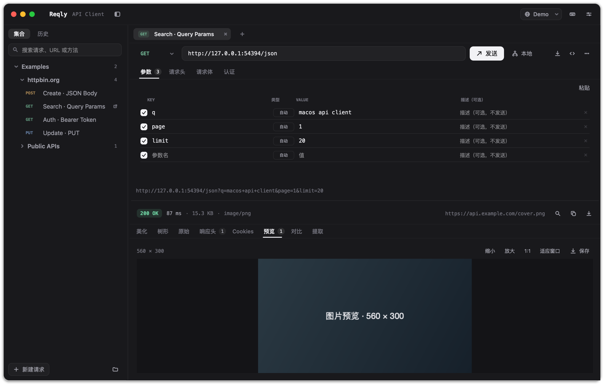
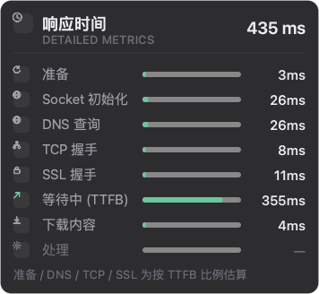
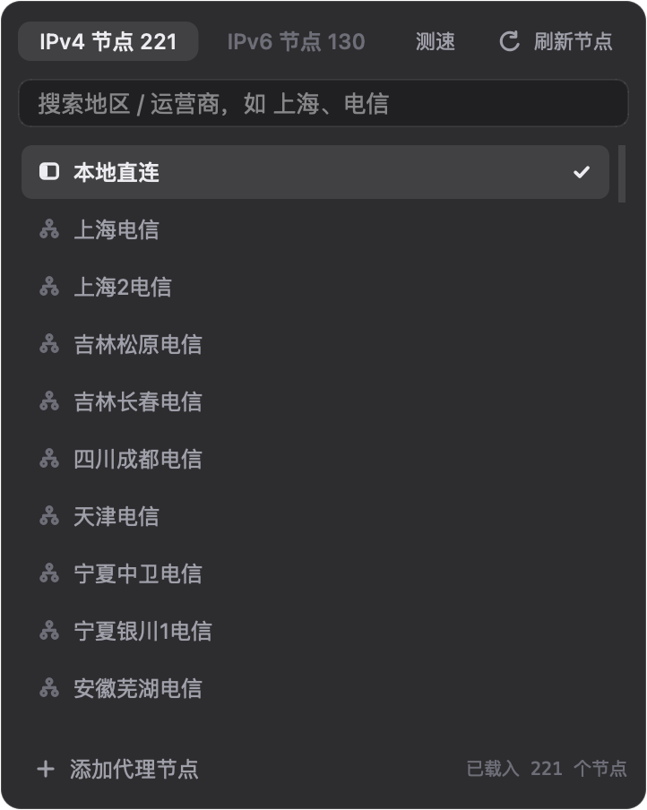
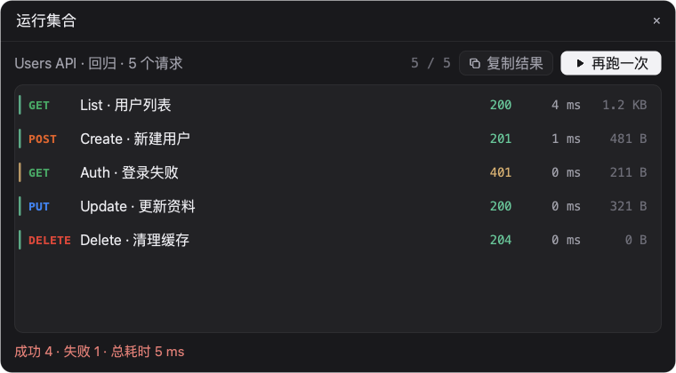
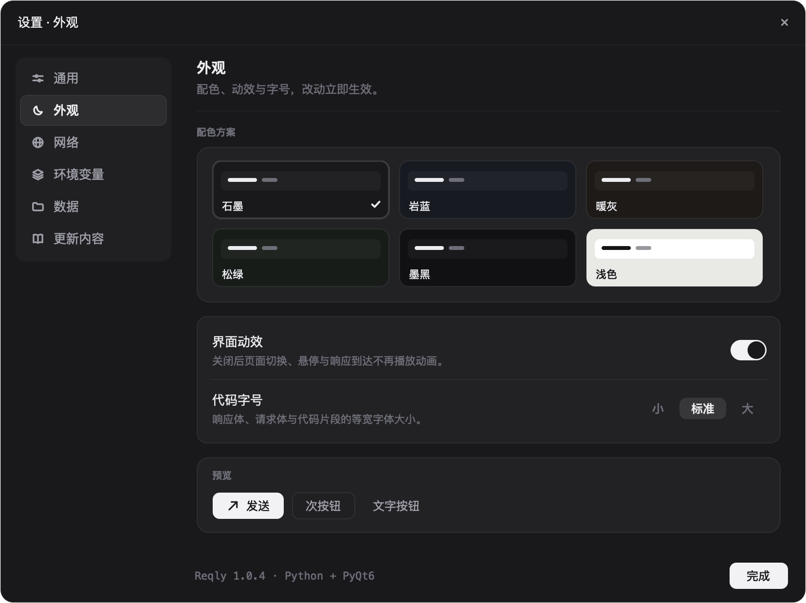
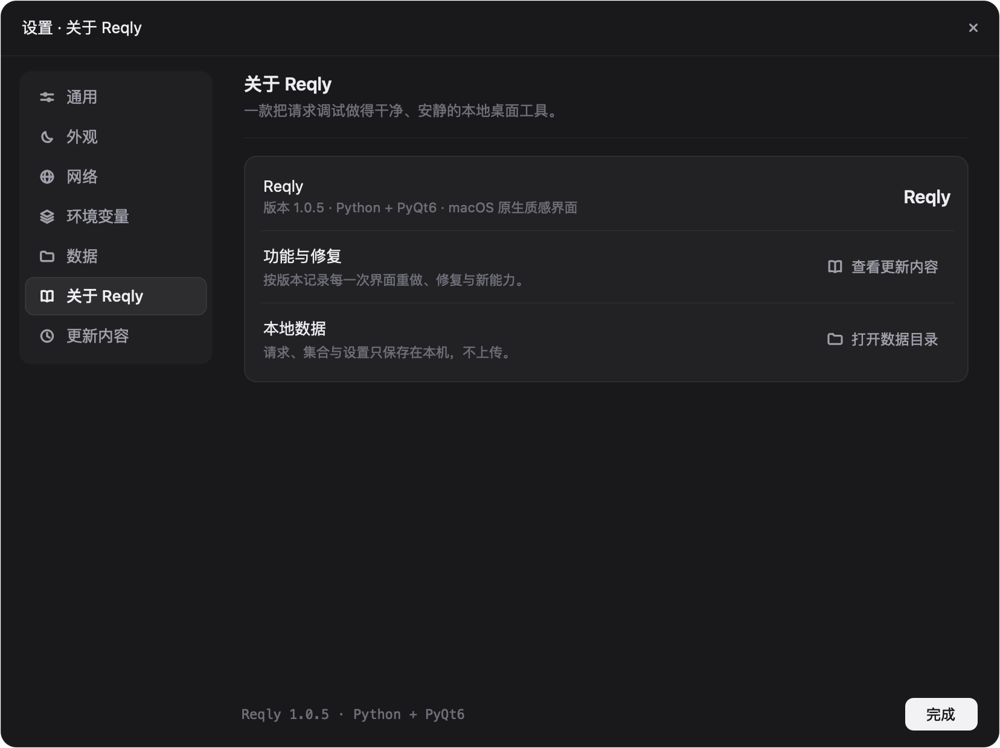
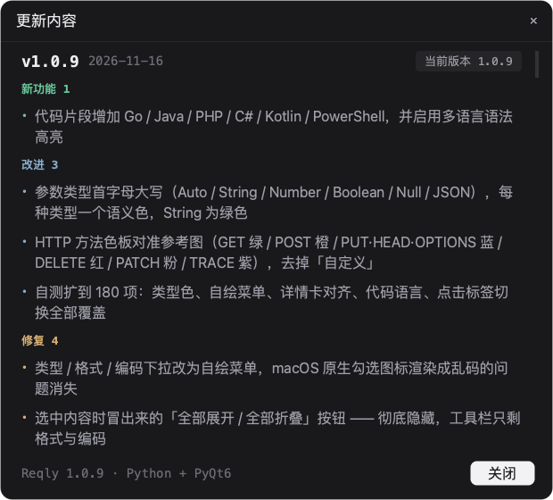

# Ocelot

**一个用 Python + PyQt6 写的 macOS 风格 API 调试客户端。** 纯黑极简界面、原生质感窗口、零图片资源；
从「发一条请求」到「出一份接口文档」的整套动作都在一个窗口里完成，并且自带一个**真的**本地 Mock 服务。

<p align="center">
  
</p>

<p align="center">
  
  
  
  
  
</p>

---

## 为什么用它

市面上不缺 API 调试工具，Ocelot 想做的是**一个不臃肿、能自己改的工具**：

- **零第三方依赖，零图片资源**。除 PyQt6 外不需要 `pip install` 任何东西；所有图标都是 `QPainterPath` 描边画出来的，
  颜色随主题实时变化，没有一张位图。
- **自带真实 Mock 服务**。不是把公开接口地址塞进地址栏，而是在 `127.0.0.1` 起一个 `http.server`：
  路由、状态码、延迟、响应体自己写，能按请求头 / 参数 / 请求体做条件规则，还能生成 `{{@uuid}}` 这类动态数据。
  断网也能调，前端和脚本都能连。
- **能出文档**。一次请求跑完，点「接口文档」得到一份带概览、鉴权、Cookies、响应头、状态码语义和十种语言
  代码示例的 Markdown，可以直接交付。密钥会被自动打码。
- **界面是画出来的，不是拼出来的**。自绘按钮、分段控件、下拉菜单、悬浮提示、右键菜单，深浅双主题 + 7 种强调色，
  连右键菜单里的「复制」都是中文带图标的。
- **可测**。`tools/smoke.py` 里有 382 项功能断言，覆盖请求链路、持久化、Mock 服务、排版对齐与鼠标交互，
  改完跑一遍就知道有没有弄坏东西。

## 快速开始

```bash
git clone https://github.com/shaoao/Oceloat.git
cd Oceloat
python3 -m pip install PyQt6
python3 main.py
```

macOS 下也可以双击 `启动 Ocelot.command`，或直接

```bash
open "启动 Ocelot.command"
```

要求 **Python 3.10+**、**PyQt6 6.5+**（开发环境为 Python 3.13 + PyQt6 6.12）。
首次启动会写入一份示例集合（httpbin.org、JSONPlaceholder），不需要联网也能先把界面点一遍。

## 界面

| 深色主界面 | 浅色主题 |
| --- | --- |
|  |  |

| 响应美化 | 图像 / 媒体预览 |
| --- | --- |
|  |  |

| 耗时详情卡（固定位置） | 请求节点面板 |
| --- | --- |
|  |  |

| 集合运行器 | 设置 · 外观 |
| --- | --- |
|  |  |

| 关于 Ocelot | 更新内容 |
| --- | --- |
|  |  |

## 功能

### 请求构造

- 方法：GET / POST / PUT / PATCH / DELETE / HEAD / OPTIONS / TRACE，每种一个语义色
- 参数与请求头：逐行启用开关、类型列（Auto / String / Number / Boolean / Null / JSON）、描述列、
  上移 / 下移 / 复制 / 删除、顶部批量启用、底部自动追加空行、Header 键名自动补全
- 智能粘贴：`a=1&b=2`、`{"q":"x"}`、多行 `k: v` 或 Tab 分隔、`#` 注释行，一次拆成参数行
- URL 与参数表双向同步：`?a=1&b=2` 自动拆进表格，清空参数不留幽灵参数
- 请求体：none / JSON / 文本 / multipart 表单（参数类型选 File 直接上传）/ `x-www-form-urlencoded` / 二进制
- JSON 实时校验（字段计数 + 错误定位）、一键格式化与压缩
- Cookies 独立一栏：表格里的 Cookie 自动合并进 `Cookie` 头；响应带 `Set-Cookie` 时一键导入
- 认证：Bearer Token / Basic / API Key（请求头或查询参数注入）
- 变量：`{{变量}}` 占位符 + `{{$timestamp}}`、`{{$uuid}}`、`{{$randomInt}}`

### 发送与响应

- 异步发送（`QNetworkAccessManager`），不阻塞界面，发送中可取消；超时 / 跟随重定向 / SSL 校验可配
- 请求节点：默认本机直连；可选 tcping.cn 的 221 个 IPv4 + 130 个 IPv6 真实节点，请求真的由节点服务器转发，
  指标行显示出口 IP、地区、节点名与耗时；也支持自建 `socks5://` / `http://` 代理
- Cookie 显式管理（关掉 Qt 自带隐式 Cookie 罐，手写的 `Cookie` 头不会被悄悄改写）
- 响应指标：状态码 + 短语、耗时（数字滚动）、体积、内容类型、最终 URL、出口 IP 与地区；
  悬浮耗时 / 体积弹出固定位置详情卡：分段条形图（准备 / DNS / TCP / SSL / TTFB / 下载）
- 八种视图：美化（JSON 高亮）/ 树形 / 原始 / 响应头 / Cookies / 预览（图片缩放平移、音视频播放、十六进制）/
  对比（与同地址上一次响应逐行 diff）/ 提取（`a.b[0].c`、`*` 路径取值）
- 内容类型按魔术字节嗅探，二进制响应自动进预览；预览页可把图片 / 音视频 / PDF / 二进制直接存盘
- 响应内查找（⌘F）：全部高亮 + 计数 + 上下跳转
- 提取结果「存为变量」，随后 `{{名字}}` 直接引用

### 本地 Mock 服务

不联网、不装依赖，`127.0.0.1` 上起一个真的 HTTP 服务：

- 路由：方法 + 路径 + 状态码 + 内容类型 + 响应体，支持前缀通配 `/api/users/*`
- 延迟：`delay` 毫秒后返回，用来测 Loading、骨架屏与超时逻辑
- 动态数据：响应体里写 `{{@id}}` `{{@uuid}}` `{{@name}}` `{{@cname}}` `{{@email}}` `{{@phone}}`
  `{{@city}}` `{{@now}}` `{{@int(1,99)}}` `{{@pick(a,b)}}`，每个请求现算一次
- 条件规则：按 请求头 / 查询参数 / 请求体 / 方法 / 路径 匹配（等于 / 包含 / 存在 / 不存在 / 正则 /
  前缀 / 大于 / 小于），第一条命中的规则可覆盖状态码、延迟与响应体 —— 带 token 返回 VIP 数据，不带返回 401
- 回显模式：把收到的请求原样返回，用来查「客户端到底发了什么」
- 请求日志：最近 200 次请求的方法 / 路径 / 状态 / 耗时 / 命中的路由与规则；路由列表显示命中次数
- CORS 全开，浏览器里跨域直接调；端口被占会明确告知并换端口；停服务时连同 keep-alive 老连接一起断开

### 组织与复用

- 集合树：无限层级、拖拽排序、右键新建 / 重命名 / 复制 / 删除 / 复制为 cURL、搜索过滤
- 集合运行器（⌘⇧R）：按树顺序跑完整个集合，逐条状态码 / 耗时 / 体积，底部汇总，可中途停止、复制 TSV 结果
- 历史记录（最多 240 条）：点击回填、悬停删除、一键清空
- 多标签：拖拽重排、中键关闭、会话恢复；侧栏单击进入 VSCode 式预览、双击固定
- 环境变量：多环境、激活切换、行启用开关
- 代码生成：cURL / Python / JavaScript / HTTPie / Go / Java / PHP / C# / Kotlin / PowerShell，十种语言带高亮
- 导入：cURL 命令一键解析；集合导入导出（Ocelot JSON，兼容 Postman v2.1，环境变量一起带走）
- 云同步（Turso）：填数据库地址与 Auth Token，「测试连接」只跑一条 `SELECT 1`；可手动上传 / 从云端恢复
  （恢复前自动备份 `state.json.bak`），也能勾「退出时自动上传」。只走 Turso 的 HTTP pipeline，不引入新依赖
- 命令面板（⌘K）：模糊搜索请求、执行命令、切换环境、直达外观与云同步设置

### 界面

- 整窗单一底色，五级灰阶 + 低饱和语义色；主按钮反色实心，**无渐变、无彩色光晕**
- 六套配色：石墨 `#19191C`（默认）/ 岩蓝 / 暖灰 / 松绿 / 墨黑 / 浅色，设置页内实时预览
- 7 种强调色（自动 / 海蓝 / 松青 / 苔绿 / 陶橙 / 绯红 / 藤紫），选中后整套界面同步变色
- 无边框圆角窗口、交通灯按钮、边缘拖拽缩放、双击标题栏缩放
- 自绘控件：悬停淡入、按压缩放、分段标签滑动下划线、选中胶囊滑动、带图标与对号的下拉菜单
- 中文文本右键菜单（撤销 / 重做 / 剪切 / 复制 / 粘贴 / 删除所选 / 全选），替换 macOS 默认英文菜单
- 设置单页八分区（通用 / 外观 / 网络 / 云同步 / 环境变量 / 快捷键 / 数据 / 关于），含中英双语切换

## 快捷键

| 快捷键 | 功能 | 快捷键 | 功能 |
| --- | --- | --- | --- |
| ⌘N / ⌘T | 新建请求 | ⌘↵ | 发送 / 取消 |
| ⌘W | 关闭标签 | ⌘S | 保存到集合 |
| ⌘K | 命令面板 | ⌘F | 响应内查找 |
| ⌘B | 显示 / 隐藏侧栏 | ⌘E | 环境变量 |
| ⌘, | 设置 | ⌘⇧C | 代码片段 |
| ⌘⇧R | 运行所在集合 | ⌘1…⌘9 | 切换标签 |
| ⌃Tab / ⌃⇧Tab | 下 / 上一个标签 | 双击分隔条 | 请求响应 50 / 50 |

全部 16 个动作都能在 **设置 → 快捷键** 里重新录制或清空，改完立刻生效。

## 项目结构

```
Ocelot/
├── main.py                  启动入口（依赖缺失时给中文提示而不是 traceback）
├── app/
│   ├── main_window.py       无边框窗口、交通灯、侧栏、标签、快捷键、Toast
│   ├── theme.py             设计令牌（深浅双主题）、字体、全局样式表
│   ├── widgets.py           自绘控件库（按钮 / 分段 / 淡入堆栈 / 开关 / 骨架屏 / 题帽）
│   ├── icons.py             24×24 矢量图标（描边绘制，任意颜色，Retina 锐利）
│   ├── sidebar.py           集合树 + 历史（自绘委托、拖拽排序、右键菜单）
│   ├── request_panel.py     URL 栏 + 参数 / 请求头 / Cookies / 请求体 / 认证
│   ├── kv_editor.py         键值对编辑器（启用开关、自动追加、批量编辑）
│   ├── response_panel.py    响应面板（状态、耗时、八种视图、格式 / 编码）
│   ├── media_preview.py     图片缩放平移 / 音视频播放 / 十六进制视图
│   ├── code_editor.py       行号 + JSON 语法高亮 + JSON 树 + 格式化
│   ├── http_client.py       异步请求层
│   ├── nodes.py / relay.py  请求节点与在线中继
│   ├── codegen.py           十种语言的代码生成
│   ├── share.py             接口文档生成（Markdown）与密钥脱敏
│   ├── markdown_view.py     Markdown 渲染（标题 / 表格 / 代码块控件化）
│   ├── doc_window.py        接口文档窗口（大纲 / 代码示例 / 复制与保存）
│   ├── mock_panel.py        Mock 中心（本地服务 / 公开接口 / 请求日志）
│   ├── mock_server.py       本地 Mock 服务（路由 / 动态数据 / 条件规则 / 日志）
│   ├── shortcuts.py         快捷键注册表（默认键位 / 录制 / 冲突检查）
│   ├── store.py             状态模型与原子化持久化
│   ├── ctxmenu.py           中文文本右键菜单
│   └── i18n.py              中英双语
├── tools/
│   ├── smoke.py             功能自测（382 项断言）
│   ├── shot.py / shot2.py   离屏截图（视觉验收）
│   └── crop.py              截图局部放大
└── docs/                    截图
```

## 开发

```bash
python3 tools/smoke.py                  # 382 项功能断言（会真起一个本地 HTTP 服务）
python3 tools/shot.py main live body    # 离屏渲染截图到 /tmp/ocelot_shots
python3 tools/shot2.py method_menu settings_appearance tooltip
```

改动约定：

- 动到界面就先跑 `smoke.py`，它覆盖了排版对齐、按钮状态、鼠标事件这些容易被忽略的回归点；
- 新增功能请同步写进 `app/store.py` 的 `CHANGELOG`，版本号末位 +1，用户能在「更新内容」里看到；
- 颜色一律走 `theme.py` 的令牌，别在控件里写死色值；图标一律用 `icons.py` 描边画，不要引入图片。

## 数据存储

`~/Library/Application Support/Ocelot/state.json`，纯 JSON、原子写入（先写临时文件再 rename）。

早期版本叫 Reqly，数据在 `~/Library/Application Support/Reqly/`；首次以 Ocelot 启动时会自动迁移，
集合、环境变量与设置都不会丢。

开了云同步之后，同一份快照还会写进 Turso 的 `ocelot_sync` 表（k / v / updated_at），
换台机器填上同样的地址与 Token 就能「从云端恢复」。

## 常见问题

**响应正文乱码或一片空白**
响应头带 `Content-Encoding: gzip / deflate / br` 时会先解压；页面没有声明 charset 时依次按 UTF-8、GB18030 解码。
仍不正常可在「原始」视图看字节，或看「响应头」里的实际编码。

**点了 IDE 的 ▶ 运行没反应**
运行面板用的解释器不一定装着 PyQt6。启动时会打印当前解释器路径与修复命令
（`<解释器> -m pip install PyQt6`），也可以直接在终端 `python3 main.py`。

**Mock 面板显示已停止，浏览器却还能访问？**
1.0.18 起停止服务会主动断开所有活着的连接（之前只关监听端口，浏览器那条 keep-alive 老连接还能继续被响应）。
如果仍然能访问，留意面板提示：`8787` 可能被另一个 Ocelot 实例或别的程序占着，换个端口即可。

## 参与

Issue 与 PR 都欢迎。提交前请确保 `python3 tools/smoke.py` 全绿，并在 PR 描述里写清楚「改了什么、
为什么改、怎么验证的」。界面相关的改动建议附一张截图。

## License

[MIT](LICENSE) © 2026 shaoao
